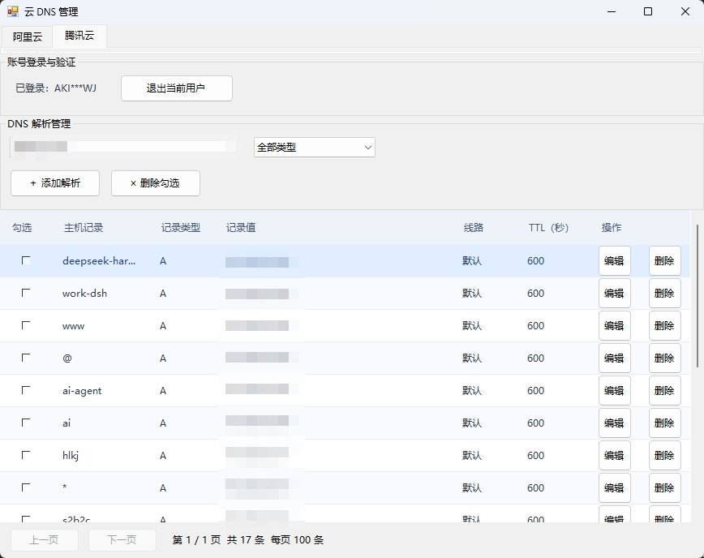

# 云 DNS 管理

基于 C# Windows Forms 的 Windows 桌面工具，在同一界面管理阿里云 DNS 和腾讯云 DNSPod 的域名解析记录。

## 凭据与隐私

**软件不在项目文件、配置文件或自建密码文件中保存明文密钥，账号凭据交由 Windows 自带的凭据管理器保存和读取。**

- 登录使用云服务 API 密钥，不是云控制台的登录密码：阿里云使用 AccessKey ID / AccessKey Secret，腾讯云使用 SecretId / SecretKey。
- 通过 Windows 原生凭据接口保存凭据；按服务商和账号分别保存，支持多个账号同时保持登录，兼容旧版单账号凭据。
- 点击“＋ 添加账号”弹出登录窗口，输入 ID 和 KEY；KEY 使用密码框显示，登录成功后清空输入并关闭弹窗，主窗口只保留脱敏账号页签。
- 点击账号页签右侧的关闭按钮并确认后，只删除该账号在 Windows 凭据管理器中的凭据并退出登录；取消则保留原状，其他账号保持登录。关闭软件主窗口不会自动删除凭据，也不会撤销云平台上的 API 密钥。

这里的“不保存明文密钥”指不写入应用自行维护的文件；凭据仍会持久保存在 Windows 凭据管理器中，并在调用云 API 时读取到进程内存。

## 软件截图



<!-- 在这里替换为软件截图；发布前请遮盖账号信息、域名和解析记录等敏感内容。 -->

## 主要功能

- 在阿里云与腾讯云之间切换，各自提供独立的多账号页签；通过“＋ 添加账号”登录其他账号，切换账号页签查看对应域名和解析，无需退出其他账号。
- 查看主机记录、记录类型、记录值、线路、TTL 和云端备注。
- 表格支持鼠标拖选多个单元格、Ctrl+C 复制、右键复制选中内容；Ctrl+A 选择当前页全部单元格，复制选区和删除勾选相互独立。
- 按记录类型筛选，每页固定显示 100 条，支持上一页、下一页及总数显示。
- 添加解析，编辑主机记录、类型、记录值和备注；支持行内“编辑”按钮及双击数据单元格打开编辑窗口。备注可清空，并同步保存到云端；新增记录后可通过编辑填写备注。
- 删除单条记录，或删除当前页勾选的多条记录；删除前弹窗确认。
- 修改和删除前重新读取记录，检查记录是否已变化。
- Debug 版本按日期记录网络请求、响应及错误；Release 版本关闭日志。

添加窗口提供 A、AAAA、CNAME、MX、TXT、NS 类型选项。具体记录是否可提交，以云平台接口的校验结果为准。

## 运行与构建

### 环境要求

- Windows 系统。
- .NET Framework 3.5 运行环境；安装方式参见 [Microsoft 官方说明](https://learn.microsoft.com/en-us/dotnet/framework/install/dotnet-35-windows)。
- 能访问阿里云 DNS 或腾讯云 DNSPod API，并拥有相应域名、解析记录的查询和管理权限。
- 从源码构建需安装 Visual Studio / MSBuild 及 .NET Framework 3.5 开发工具和目标框架引用程序集。

当前项目使用 .NET Framework 自带程序集，未引用第三方 NuGet 包或云厂商 SDK，也不依赖数据库。

### Visual Studio

1. 打开项目根目录的 `dnspod.sln`。
2. 选择 `Debug` 或 `Release`，平台选择 `Any CPU`。
3. 生成解决方案，运行生成的 `dnspod.exe`。

### 命令行

在 Visual Studio 开发人员命令提示符中，进入包含 `dnspod.csproj` 的目录后执行：

```powershell
msbuild dnspod.csproj /t:Build /p:Configuration=Release /p:Platform=AnyCPU
```

默认 Release 输出为 `bin\Release\dnspod.exe`，Debug 输出为 `bin\Debug\dnspod.exe`。构建参数参见 [MSBuild 官方文档](https://learn.microsoft.com/en-us/visualstudio/msbuild/msbuild-command-line-reference)。若提示输出文件被占用，请先关闭正在运行的程序再生成。

## 使用方法

1. 启动程序，选择“阿里云”或“腾讯云”页签。
2. 点击“＋ 添加账号”，在弹窗中按服务商填写 ID、KEY，点击“登录并验证”。

   | 服务商 | ID 输入框 | KEY 输入框 |
   | --- | --- | --- |
   | 阿里云 | AccessKey ID | AccessKey Secret |
   | 腾讯云 | SecretId | SecretKey |

3. 选择域名，查看解析记录；可使用类型下拉框筛选和底部按钮翻页。
   多账号使用：在服务商下方点击“＋ 添加账号”，输入另一个账号的密钥。已登录账号保留在独立页签中，阿里云账号和腾讯云账号分别管理；同一账号重复登录更新密钥，不新增重复页签。
4. 点击“添加解析”新增记录，或使用每行的“编辑”“删除”按钮操作。
5. 批量删除时勾选当前页记录，再点击“删除勾选”。翻页或重新加载列表会清除勾选。
6. 不再保留某个账号凭据时，点击该账号页签右侧的关闭按钮，在确认窗口选择“是”；选择“否”则取消退出。关闭非当前账号不会切换或刷新正在查看的记录。

账号页签沿用 WinForms `TabControl`。该控件没有内置页签关闭属性，因此使用官方 `DrawItem` 扩展和 `ControlPaint.DrawCaptionButton` 的 `CaptionButton.Close` 绘制系统关闭图标，仅补充点击命中和退出确认逻辑，未引入第三方控件。

## 日志与排查

仅 Debug 版本记录日志，保存于可执行文件所在目录下的 `logs/`，文件名为 `network-yyyy-MM-dd.log`。请求和响应带有对应的请求标识，便于关联排查。Release 版本在编译时移除日志调用，不会因网络日志创建 `logs/` 目录或写入日志文件；已有日志不会自动删除。

日志对 Authorization 等认证头及部分密钥、签名参数做脱敏，但仍包含域名和解析记录等业务信息；分享日志前应检查内容。`.gitignore` 已排除运行日志、构建产物和 Visual Studio 本机缓存。

登录或读取失败时，可结合界面错误检查 API 密钥、权限、域名归属与网络连接；需要网络日志时使用 Debug 版本。写入请求失败后，应先在云控制台核实实际结果，再决定是否重试。

## 当前限制

- 解析记录先分批从云端加载，再在界面按每页 100 条显示；网络请求目前同步执行，记录较多时加载可能较慢。
- 腾讯云域名列表已循环分页；阿里云域名列表目前只请求默认第一页，账号域名较多时可能显示不全。
- 编辑窗口开放主机记录、类型、记录值和备注，未提供线路、TTL、权重或优先级的独立编辑入口。
- 解析内容和备注使用云厂商各自的原生修改接口；同时修改两者时分步提交，无法跨接口原子保存。若备注失败，会提示解析内容已更新并重新读取记录，请核实结果后再操作。
- 添加、编辑、删除后重新加载列表，返回第一页并恢复“全部类型”。
- 批量删除逐条执行，失败后停止；已成功删除的记录不会自动回滚。
- 修改、删除前的记录比对不是云端原子锁，不能完全消除其他客户端同时修改带来的竞争。

## 项目结构

| 文件 | 职责 |
| --- | --- |
| `Program.cs` | WinForms 程序入口 |
| `Form1.cs` | 主窗口、分页、记录操作及添加/编辑窗口 |
| `Form1.Designer.cs` / `Form1.resx` | 窗体初始化及资源 |
| `DnsProviders.cs` | 两家云 API 请求、签名、记录检查及网络日志 |
| `CredentialStore.cs` | Windows 凭据管理器读写和删除 |
| `CloudModels.cs` | 服务商、凭据、域名和记录模型 |
| `Properties/` | 程序集信息、资源和设置 |
| `dnspod.csproj` / `dnspod.sln` | 项目及解决方案配置 |
